# Отчёт по практике 7.1: ассистент для код-ревью в n8n

## Окружение

- Репозиторий практики: [sergeevroma/N8N_practice](https://github.com/sergeevroma/N8N_practice).
- Первая модель: `openai/gpt-5`, провайдер VseLLM.
- Вторая модель: `anthropic/claude-sonnet-4.5`, провайдер VseLLM.
- Итоговый workflow: TODO — добавить ссылку на финальный JSON в `workflows/`.

## 1. Классная работа: ревью только при открытии PR

**Статус:** подтверждено реальными запусками.

**Workflow:** [single_agent_without_command.json](workflows/single_agent_without_command.json).

**Что настроено:** GitHub Trigger получает события `pull_request`; IF пропускает только
`action = opened`. Две HTTP-ноды получают diff и README из коммита ветки PR.
Merge объединяет их в один элемент. Агент формирует ревью, GitHub-ноды публикуют его
и устанавливают метку `ReviewedByAI`.

**Тестовый PR:** [N8N_practice #1: bug-discount → main](https://github.com/sergeevroma/N8N_practice/pull/1).

**Результат ревью:** модель обнаружила ошибку в `shop.py`: выражение
`price * (1 + percent / 100)` увеличивает цену вместо применения скидки.
Для `price = 100`, `percent = 20` получается 120 вместо 80.
В опубликованном ревью предложено исправление: `price * (1 - percent / 100)`.
PR получил метку `ReviewedByAI`.

| Проверка | Ожидаемый результат | Фактический результат | Доказательство |
|---|---|---|---|
| Открыть новый PR | Опубликовано ревью, установлена метка | Execution №190 успешно выполнил всю цепочку; ревью и метка появились в PR | [Execution](screenshots/01_pr_opened/execution_opened.png), [результат в PR](screenshots/01_pr_opened/pr_review.png) |
| Закрыть PR без слияния | IF выбирает false, модель и публикация не выполняются | Execution №192 завершился после триггера и IF; HTTP-ноды, модель и публикация не выполнялись | [Execution](screenshots/01_pr_opened/execution_closed.png) |
| Повторно открыть PR | Событие reopened отсекается, нового ревью нет | Execution №193 завершился после триггера и IF; повторное ревью не выполнялось | [Execution](screenshots/01_pr_opened/execution_reopend.png) |

**Схема workflow:**

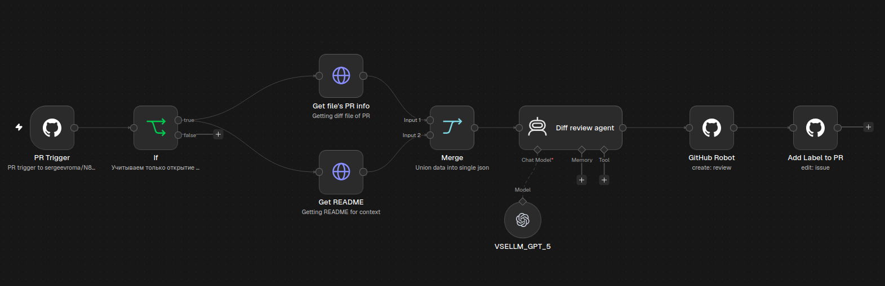

**Успешный запуск при открытии PR, Execution №190:**

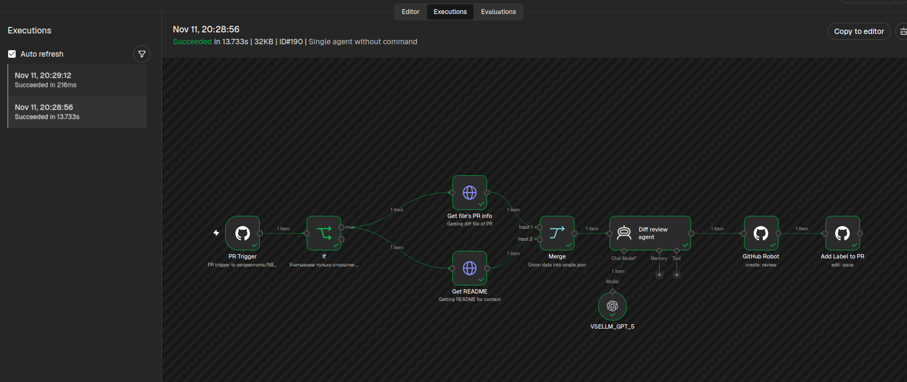

**Опубликованное ревью и метка:**

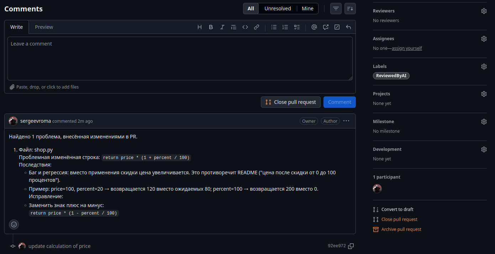

**Закрытие PR без слияния, Execution №192:**

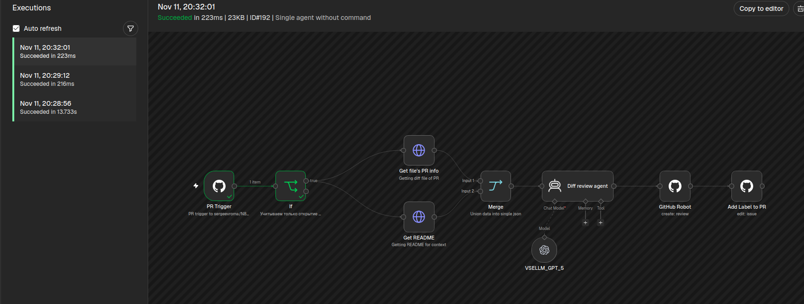

**Повторное открытие PR, Execution №193:**

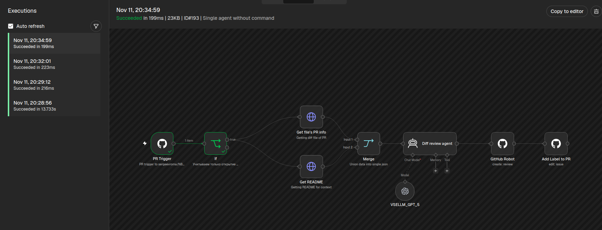

## 2. Классная работа: ревью по команде /make_ai_review

**Статус:** подтверждено реальными запусками.

**Workflow:** [single_agent_with_command.json](workflows/single_agent_with_command.json).

**Что изменено:** GitHub Trigger переключён на событие `issue_comment`.
IF пропускает только новый комментарий (`action = created`), который относится к PR
и после удаления пробелов по краям совпадает с `/make_ai_review`.
Нода `Get PR details` получает сведения о PR для последующих запросов diff и README.
Открытие PR само по себе ревью не запускает.

**Тестовый PR:** [N8N_practice #2: bug-stock → main](https://github.com/sergeevroma/N8N_practice/pull/2).
Команда `/make_ai_review` и ответ модели показаны на [скриншоте обсуждения](screenshots/02_review_command/pr_review.png).

**Результат ревью:** модель обнаружила ошибку в `can_buy` файла `shop.py`:
условие `requested < stock` запрещает покупку всего остатка товара.
Для `stock = 5`, `requested = 5` функция возвращает `False` вместо `True`.
В ревью предложено восстановить `requested <= stock`; PR получил метку `ReviewedByAI`.

| Проверка | Ожидаемый результат | Фактический результат | Доказательство |
|---|---|---|---|
| Открыть PR | Автоматического ревью нет | После открытия PR ревью и метка отсутствовали | [PR до команды](screenshots/02_review_command/pr_before_command.png) |
| Написать обычный комментарий в PR | Модель и публикация не выполняются | Execution №194 завершился после триггера и IF; дальнейшие ноды не выполнялись | [Execution](screenshots/02_review_command/execution_ignored.png) |
| Написать /make_ai_review в PR | Основная модель публикует ревью | Execution №195 успешно выполнил всю цепочку; опубликовано ревью и установлена метка | [Execution](screenshots/02_review_command/execution_command.png), [результат в PR](screenshots/02_review_command/pr_review.png) |

**Схема workflow:**

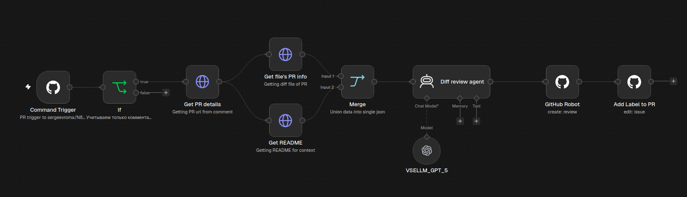

**PR после открытия, до отправки команды:**

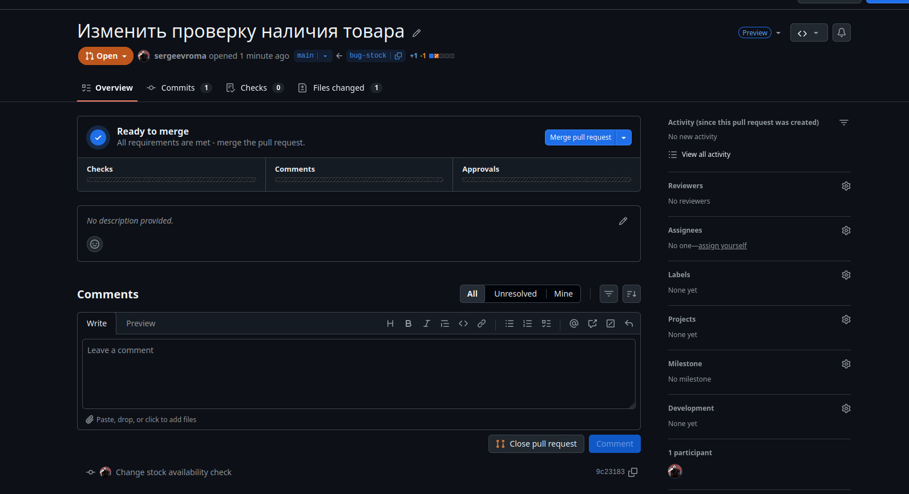

**Обычный комментарий, Execution №194:**

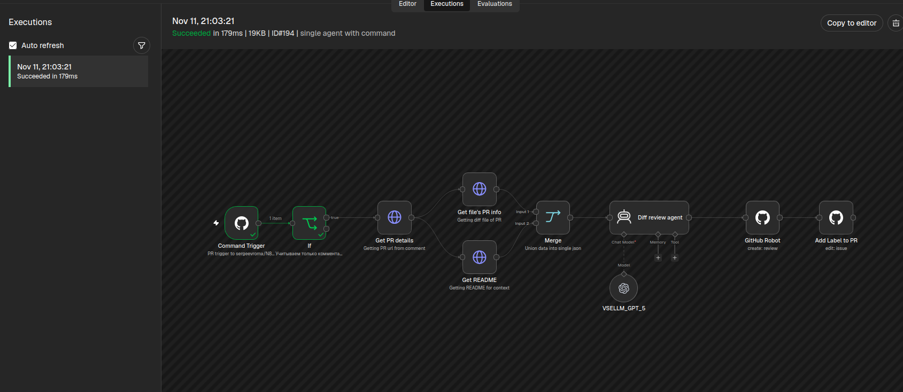

**Запуск по /make_ai_review, Execution №195:**

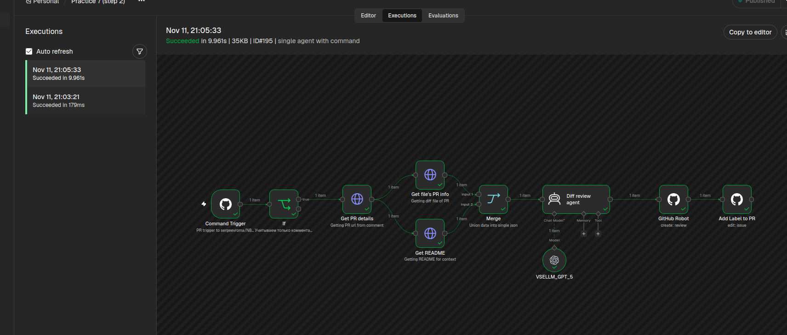

**Команда, опубликованное ревью и метка:**

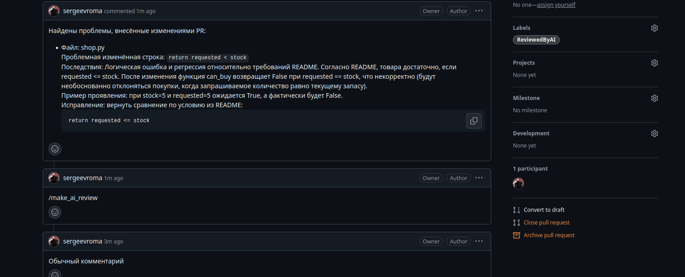

## 3. Домашняя работа: вторая модель

**Статус:** подтверждено опубликованными ревью и схемой workflow.

**Workflow:** [two_agents_with_command.json](workflows/two_agents_with_command.json).

**Что изменено:** IF принимает обе команды в новых комментариях к PR.
После получения diff и README нода Switch выбирает агента:
`/make_ai_review` направляется к GPT-5, а `/make_other_ai_review` — к Claude Sonnet 4.5.
GPT-5 использует общий промпт для ревью Python-кода; промпт Claude делает акцент
на требованиях README и граничных случаях, запрашивает минимальный пример ошибки,
исправление и короткий `assert`. Оба агента используют общие ноды публикации ревью
и установки метки `ReviewedByAI`. В заголовке нового ревью указывается модель.

**Тестовый PR:** [N8N_practice #2: bug-stock → main](https://github.com/sergeevroma/N8N_practice/pull/2).
Для сравнения используется тот же PR. Результат GPT-5 приведён в разделе 2;
его скриншот используется повторно. Для Claude добавлен отдельный скриншот ответа
на `/make_other_ai_review`.

| Команда | Использованная модель | Фактический результат | Доказательство |
|---|---|---|---|
| /make_ai_review | `openai/gpt-5` | Обнаружена ошибка `requested < stock`: при покупке всего остатка возвращается `False`; предложено восстановить `requested <= stock` | [Ревью GPT-5 из раздела 2](screenshots/02_review_command/pr_review.png) |
| /make_other_ai_review | `anthropic/claude-sonnet-4.5` | Опубликовано ревью с тем же дефектом, минимальным примером, исправлением и примерами `assert` для граничных случаев | [Ревью Claude](screenshots/03_second_model/pr_review_claude.png) |

**Сравнение результатов:** обе модели нашли один и тот же дефект в `shop.py`
и предложили одинаковое исправление: `return requested <= stock`.
Для `stock = 5`, `requested = 5` обе указали ожидаемый результат `True`
и фактический `False`. GPT-5 кратко описал нарушение требований и исправление.
Claude дополнительно предложил `assert` для равенства запроса и остатка,
запроса меньше и больше остатка, а также случая `stock = requested = 0`.

**Схема workflow с выбором агента:**

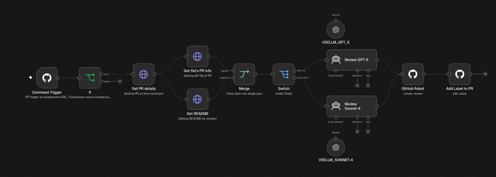

**Ревью GPT-5 по /make_ai_review, скриншот из раздела 2:**

**Ревью Claude Sonnet 4.5 по /make_other_ai_review:**

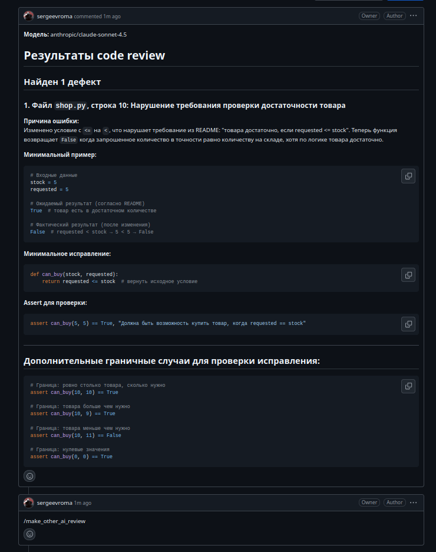

## 4. Домашняя работа: сохранение состояния в Data Table

**Статус:** не подтверждено.

**Workflow:** TODO — экспортировать в `workflows/data_table.json` и добавить ссылку.

**Таблица и её поля:** TODO — указать название, структуру и используемый идентификатор PR.

**Когда сохраняется запись:** TODO — описать место записи относительно успешной публикации ревью.

**Тестовый PR:** TODO — добавить ссылку.

| Проверка | Ожидаемый результат | Фактический результат | Доказательство |
|---|---|---|---|
| Выполнить ревью PR | После ревью его id сохранён в Data Table | TODO | TODO |

**Скриншоты:** `screenshots/04_data_table/` — Execution с выполненной записью,
содержимое таблицы с идентификатором проверенного PR.

## 5. Домашняя работа: исключение повторного ревью

**Статус:** не подтверждено.

**Workflow:** TODO — экспортировать в `workflows/deduplication.json` и добавить ссылку.

**Как принимается решение:** TODO — описать поиск PR в таблице и ветки выполнения.

**Тестовый PR и команды:** TODO — добавить ссылки на первый и повторный комментарии.

| Проверка | Ожидаемый результат | Фактический результат | Доказательство |
|---|---|---|---|
| /make_ai_review для PR, которого нет в таблице | Ревью опубликовано, id сохранён | TODO | TODO |
| Повторный /make_ai_review для того же PR | Модель и публикация пропущены, дублирующая запись не создаётся | TODO | TODO |

**Скриншоты:** `screenshots/05_deduplication/` — первый и повторный Executions,
содержимое Data Table. На повторном запуске должна быть видна ветка пропуска ревью.

## 6. Домашняя работа со звёздочкой: точечные комментарии

**Статус:** не подтверждено.

**Workflow:** TODO — экспортировать в `workflows/inline_comments.json` и добавить ссылку.

**Как разбивается diff:** TODO — описать выделение блоков изменённого кода.

**Как комментарий связывается с кодом:** TODO — описать используемые путь файла,
строку, сторону diff и коммит.

**Тестовый PR с несколькими блоками изменений:** TODO — добавить ссылку.

| Проверка | Ожидаемый результат | Фактический результат | Доказательство |
|---|---|---|---|
| Выполнить ревью PR с несколькими изменёнными блоками | У каждого блока есть комментарий с корректной привязкой к строке | TODO | TODO |

**Скриншоты:** `screenshots/06_inline_comments/` — Execution обработки блоков
и комментарии возле соответствующих изменённых строк в PR.

## Итог сдачи

- [ ] Добавлены ссылки на выполненные версии workflow и выбран финальный JSON.
- [ ] Добавлены ссылки на тестовые PR и результаты ревью.
- [ ] Приложены схемы workflow и результаты ревью; для проверок запуска и пропуска — реальные Executions.
- [ ] Для сохранения состояния и дедупликации показано содержимое Data Table.
- [ ] Пояснены выбор модели, хранение состояния и пропуск повторного ревью.
- [ ] Для выполненной звёздочки показана привязка комментариев к блокам кода.

**Выполненные этапы и ограничения:** TODO — заполнить по фактическим результатам.
