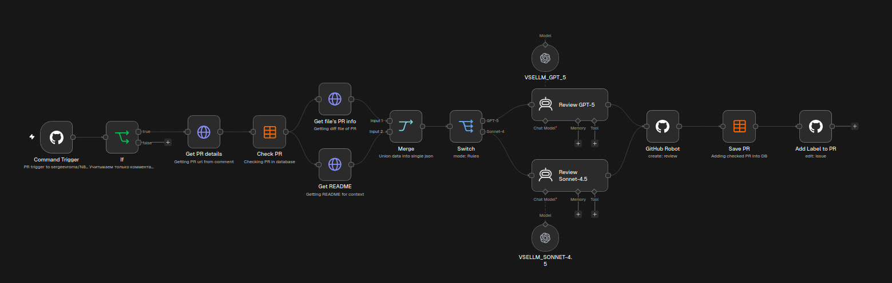
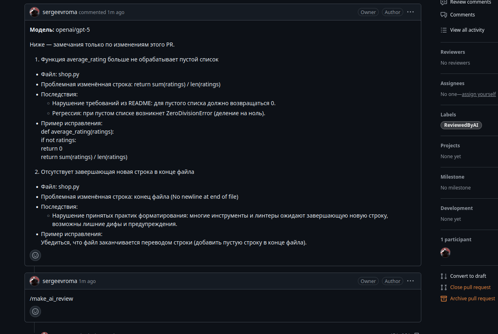
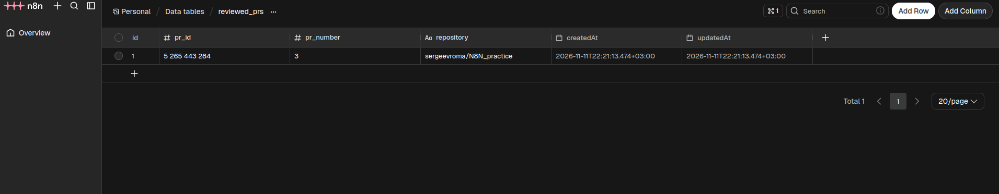
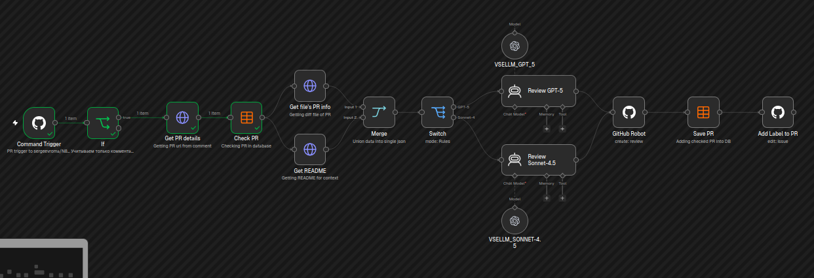
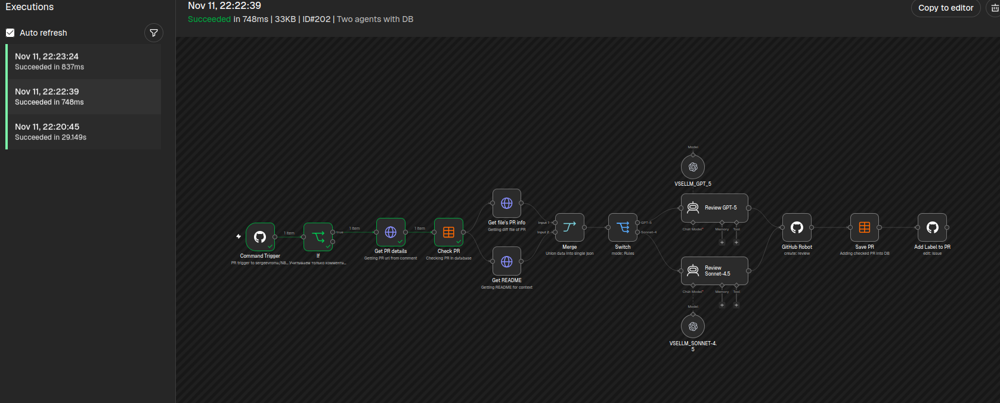

# Отчёт по практике 7.1: ассистент для код-ревью в n8n

## Окружение

- Репозиторий практики: [sergeevroma/N8N_practice](https://github.com/sergeevroma/N8N_practice).
- Первая модель: `openai/gpt-5`, провайдер VseLLM.
- Вторая модель: `anthropic/claude-sonnet-4.5`, провайдер VseLLM.
- Итоговый workflow: [two_agents_with_db.json](workflows/two_agents_with_db.json).

## 1. Классная работа: ревью только при открытии PR

**Статус:** подтверждено реальными запусками.

**Workflow:** [single_agent_without_command.json](workflows/single_agent_without_command.json).

**Что настроено:** GitHub Trigger получает события `pull_request`; IF пропускает только
`action = opened`. Две HTTP-ноды получают diff и README из коммита ветки PR.
Merge объединяет их в один элемент. Агент формирует ревью, GitHub-ноды публикуют его
и устанавливают метку `ReviewedByAI`.

**Тестовый PR:** [N8N_practice #1: bug-discount → main](https://github.com/sergeevroma/N8N_practice/pull/1).

**Результат ревью:** модель обнаружила ошибку в `shop.py`: выражение
`price * (1 + percent / 100)` увеличивает цену вместо применения скидки.
Для `price = 100`, `percent = 20` получается 120 вместо 80.
В опубликованном ревью предложено исправление: `price * (1 - percent / 100)`.
PR получил метку `ReviewedByAI`.

| Проверка | Ожидаемый результат | Фактический результат | Доказательство |
|---|---|---|---|
| Открыть новый PR | Опубликовано ревью, установлена метка | Execution №190 успешно выполнил всю цепочку; ревью и метка появились в PR | [Execution](screenshots/01_pr_opened/execution_opened.png), [результат в PR](screenshots/01_pr_opened/pr_review.png) |
| Закрыть PR без слияния | IF выбирает false, модель и публикация не выполняются | Execution №192 завершился после триггера и IF; HTTP-ноды, модель и публикация не выполнялись | [Execution](screenshots/01_pr_opened/execution_closed.png) |
| Повторно открыть PR | Событие reopened отсекается, нового ревью нет | Execution №193 завершился после триггера и IF; повторное ревью не выполнялось | [Execution](screenshots/01_pr_opened/execution_reopend.png) |

**Схема workflow:**

**Успешный запуск при открытии PR, Execution №190:**

**Опубликованное ревью и метка:**

**Закрытие PR без слияния, Execution №192:**

**Повторное открытие PR, Execution №193:**

## 2. Классная работа: ревью по команде /make_ai_review

**Статус:** подтверждено реальными запусками.

**Workflow:** [single_agent_with_command.json](workflows/single_agent_with_command.json).

**Что изменено:** GitHub Trigger переключён на событие `issue_comment`.
IF пропускает только новый комментарий (`action = created`), который относится к PR
и после удаления пробелов по краям совпадает с `/make_ai_review`.
Нода `Get PR details` получает сведения о PR для последующих запросов diff и README.
Открытие PR само по себе ревью не запускает.

**Тестовый PR:** [N8N_practice #2: bug-stock → main](https://github.com/sergeevroma/N8N_practice/pull/2).
Команда `/make_ai_review` и ответ модели показаны на [скриншоте обсуждения](screenshots/02_review_command/pr_review.png).

**Результат ревью:** модель обнаружила ошибку в `can_buy` файла `shop.py`:
условие `requested < stock` запрещает покупку всего остатка товара.
Для `stock = 5`, `requested = 5` функция возвращает `False` вместо `True`.
В ревью предложено восстановить `requested <= stock`; PR получил метку `ReviewedByAI`.

| Проверка | Ожидаемый результат | Фактический результат | Доказательство |
|---|---|---|---|
| Открыть PR | Автоматического ревью нет | После открытия PR ревью и метка отсутствовали | [PR до команды](screenshots/02_review_command/pr_before_command.png) |
| Написать обычный комментарий в PR | Модель и публикация не выполняются | Execution №194 завершился после триггера и IF; дальнейшие ноды не выполнялись | [Execution](screenshots/02_review_command/execution_ignored.png) |
| Написать /make_ai_review в PR | Основная модель публикует ревью | Execution №195 успешно выполнил всю цепочку; опубликовано ревью и установлена метка | [Execution](screenshots/02_review_command/execution_command.png), [результат в PR](screenshots/02_review_command/pr_review.png) |

**Схема workflow:**

**PR после открытия, до отправки команды:**

**Обычный комментарий, Execution №194:**

**Запуск по /make_ai_review, Execution №195:**

**Команда, опубликованное ревью и метка:**

## 3. Домашняя работа: вторая модель

**Статус:** подтверждено опубликованными ревью и схемой workflow.

**Workflow:** [two_agents_with_command.json](workflows/two_agents_with_command.json).

**Что изменено:** IF принимает обе команды в новых комментариях к PR.
После получения diff и README нода Switch выбирает агента:
`/make_ai_review` направляется к GPT-5, а `/make_other_ai_review` — к Claude Sonnet 4.5.
GPT-5 использует общий промпт для ревью Python-кода; промпт Claude делает акцент
на требованиях README и граничных случаях, запрашивает минимальный пример ошибки,
исправление и короткий `assert`. Оба агента используют общие ноды публикации ревью
и установки метки `ReviewedByAI`. В заголовке нового ревью указывается модель.

**Тестовый PR:** [N8N_practice #2: bug-stock → main](https://github.com/sergeevroma/N8N_practice/pull/2).
Для сравнения используется тот же PR. Результат GPT-5 приведён в разделе 2;
его скриншот используется повторно. Для Claude добавлен отдельный скриншот ответа
на `/make_other_ai_review`.

| Команда | Использованная модель | Фактический результат | Доказательство |
|---|---|---|---|
| /make_ai_review | `openai/gpt-5` | Обнаружена ошибка `requested < stock`: при покупке всего остатка возвращается `False`; предложено восстановить `requested <= stock` | [Ревью GPT-5 из раздела 2](screenshots/02_review_command/pr_review.png) |
| /make_other_ai_review | `anthropic/claude-sonnet-4.5` | Опубликовано ревью с тем же дефектом, минимальным примером, исправлением и примерами `assert` для граничных случаев | [Ревью Claude](screenshots/03_second_model/pr_review_claude.png) |

**Сравнение результатов:** обе модели нашли один и тот же дефект в `shop.py`
и предложили одинаковое исправление: `return requested <= stock`.
Для `stock = 5`, `requested = 5` обе указали ожидаемый результат `True`
и фактический `False`. GPT-5 кратко описал нарушение требований и исправление.
Claude дополнительно предложил `assert` для равенства запроса и остатка,
запроса меньше и больше остатка, а также случая `stock = requested = 0`.

**Схема workflow с выбором агента:**

**Ревью GPT-5 по /make_ai_review, скриншот из раздела 2:**

**Ревью Claude Sonnet 4.5 по /make_other_ai_review:**

## 4. Домашняя работа: сохранение состояния в Data Table

**Статус:** подтверждено опубликованным ревью и содержимым Data Table.

**Workflow:** [two_agents_with_db.json](workflows/two_agents_with_db.json).
Одна версия workflow реализует сохранение состояния и исключение повторного ревью.

**Таблица:** `reviewed_prs` в n8n.

| Поле | Тип | Назначение | Значение для тестового PR |
|---|---|---|---|
| `pr_id` | Number | Идентификатор PR из ответа GitHub API | `5265443284` |
| `pr_number` | Number | Номер PR в репозитории | `3` |
| `repository` | String | Полное имя репозитория | `sergeevroma/N8N_practice` |

Для поиска используется `pr_id`, полученный как `$("Get PR details").first().json.id`.
Он отличается от номера PR и служебного `id` строки таблицы.

**Когда сохраняется запись:** общая для обоих агентов нода `Save PR` стоит
после `GitHub Robot` и перед `Add Label to PR`. Она выполняет `Upsert` по `pr_id`:
создаёт запись либо обновляет существующую. Запись сохраняется после успешной
публикации ревью, независимо от выбранной модели.

**Тестовый PR:** [N8N_practice #3: bug-average → main](https://github.com/sergeevroma/N8N_practice/pull/3).
[Обсуждение с командами проверки](https://github.com/sergeevroma/N8N_practice/pull/3#issuecomment-6805170351).
В `average_rating` удалена обработка пустого списка. GPT-5 обнаружил, что
`average_rating([])` вызывает `ZeroDivisionError` вместо предусмотренного README
результата `0`, и предложил восстановить проверку `if not ratings: return 0`.
В PR опубликовано ревью и установлена метка `ReviewedByAI`.

| Проверка | Ожидаемый результат | Фактический результат | Доказательство |
|---|---|---|---|
| Выполнить ревью PR №3 | После публикации ревью его id сохранён в Data Table | GPT-5 опубликовал ревью; в `reviewed_prs` появилась строка с `pr_id = 5265443284`, `pr_number = 3` и именем репозитория | [Ревью и метка](screenshots/04_data_table/execution_saved.png), [Data Table](screenshots/04_data_table/table.png) |

**Схема workflow с проверкой и сохранением PR:**

**Опубликованное ревью GPT-5 и метка:**

**Data Table после проверок: одна запись для PR №3:**

## 5. Домашняя работа: исключение повторного ревью

**Статус:** подтверждено реальными запусками для обеих команд.

**Workflow:** [two_agents_with_db.json](workflows/two_agents_with_db.json).

**Как принимается решение:** после `Get PR details` общая нода `Check PR`
с операцией `If Row Does Not Exist` ищет `pr_id` в таблице `reviewed_prs`.
Если записи нет, она пропускает данные к получению diff и README, а затем
к выбору модели и публикации. Если запись найдена, нода не возвращает элементов,
и дальнейшие ноды не выполняются. Проверка применяется к `/make_ai_review`
и `/make_other_ai_review`: после ревью любой моделью повторное ревью этого PR
блокируется для обеих команд.

**Тестовый PR и команды:** [PR №3 и обсуждение проверки](https://github.com/sergeevroma/N8N_practice/pull/3#issuecomment-6805170351).
После первого `/make_ai_review` и сохранения записи последовательно отправлены
повторный `/make_ai_review` и `/make_other_ai_review`.

| Проверка | Ожидаемый результат | Фактический результат | Доказательство |
|---|---|---|---|
| /make_ai_review для PR, которого нет в таблице | Ревью опубликовано, id сохранён | Ревью GPT-5 опубликовано, в таблицу добавлена запись для PR №3 | [Ревью](screenshots/04_data_table/execution_saved.png), [Data Table](screenshots/04_data_table/table.png) |
| Повторный /make_ai_review для того же PR | Модель и публикация пропущены, дублирующая запись не создаётся | Выполнились только триггер, IF, получение сведений о PR и `Check PR`; последующие ноды не запускались | [Повторная основная команда](screenshots/05_deduplication/execution_skipped.png) |
| /make_other_ai_review для уже проверенного PR | Вторая модель и публикация также пропущены | Выполнение остановилось после `Check PR`; в Data Table осталась одна строка для PR №3 | [Команда второй модели](screenshots/05_deduplication/execution_other_skipped.png), [Data Table](screenshots/04_data_table/table.png) |

Каждый комментарий создаёт новый Execution, но для уже проверенного PR
не выполняются запросы diff и README, вызовы моделей, публикация ревью
и повторная запись в таблицу.

**Пропуск повторного /make_ai_review:**

**Пропуск /make_other_ai_review для того же PR:**

## 6. Домашняя работа со звёздочкой: точечные комментарии

**Статус:** не подтверждено.

**Workflow:** TODO — экспортировать в `workflows/inline_comments.json` и добавить ссылку.

**Как разбивается diff:** TODO — описать выделение блоков изменённого кода.

**Как комментарий связывается с кодом:** TODO — описать используемые путь файла,
строку, сторону diff и коммит.

**Тестовый PR с несколькими блоками изменений:** TODO — добавить ссылку.

| Проверка | Ожидаемый результат | Фактический результат | Доказательство |
|---|---|---|---|
| Выполнить ревью PR с несколькими изменёнными блоками | У каждого блока есть комментарий с корректной привязкой к строке | TODO | TODO |

**Скриншоты:** `screenshots/06_inline_comments/` — Execution обработки блоков
и комментарии возле соответствующих изменённых строк в PR.

## Итог сдачи

- [x] Добавлены ссылки на выполненные версии workflow и выбран финальный JSON.
- [x] Добавлены ссылки на тестовые PR и результаты ревью.
- [x] Приложены схемы workflow и результаты ревью; для проверок запуска и пропуска — реальные Executions.
- [x] Для сохранения состояния и дедупликации показано содержимое Data Table.
- [x] Пояснены выбор модели, хранение состояния и пропуск повторного ревью.
- [ ] Для выполненной звёздочки показана привязка комментариев к блокам кода.

**Выполненные этапы и ограничения:** выполнены оба этапа классной работы
и три основных шага домашней работы: вторая модель, сохранение PR в Data Table
и исключение повторного ревью. Задание со звёздочкой пока не выполнено.
Дедупликация действует по идентификатору PR для обеих команд; последовательные
повторные вызовы подтверждены скриншотами. Защита от одновременных запусков
до сохранения первой записи не реализована.
