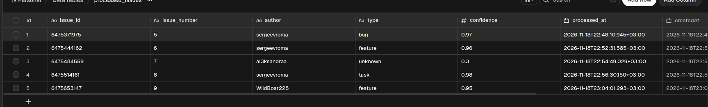
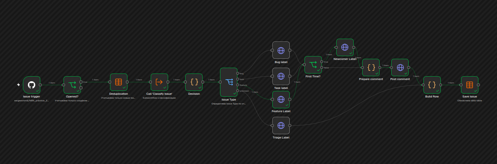
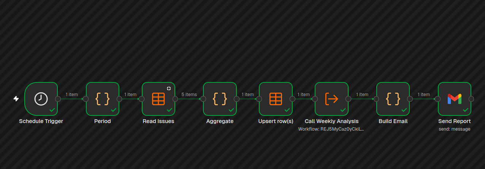
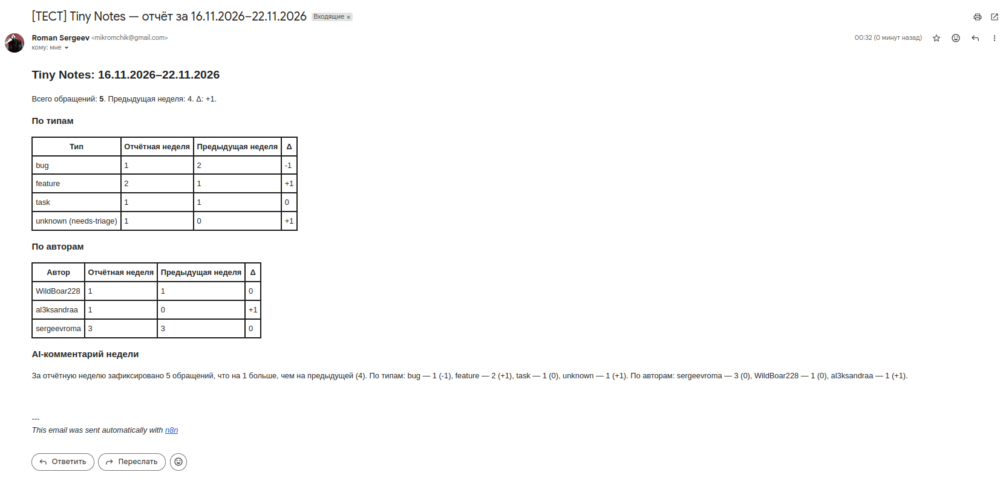
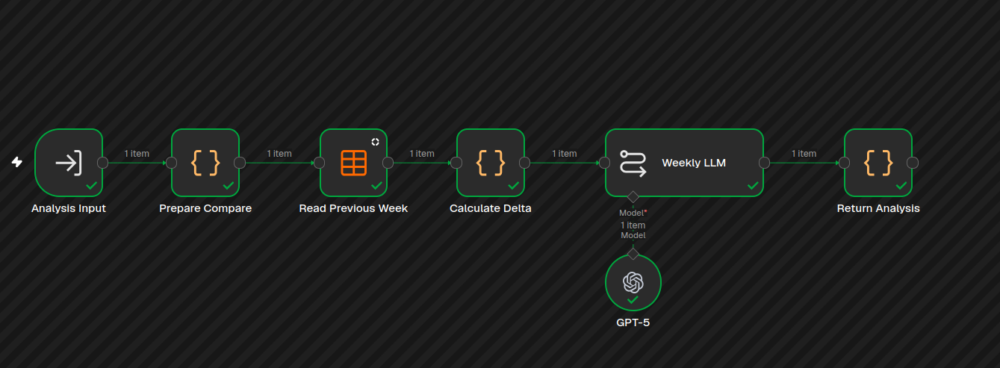

# Отчёт по практике 7.2: поддержка пользователя с помощью AI-инструментов

## Окружение

- Тестовый репозиторий: [sergeevroma/N8N_practice_2](https://github.com/sergeevroma/N8N_practice_2).
- Проект: Tiny Notes — консольный блокнот на Python с JSON-хранилищем,
  командами `add`, `list`, `search` и аргументом `--file`.
- Модель классификатора: `openai/gpt-5`, провайдер VseLLM.
- Основной сценарий: [01_issue_triage.json](workflows/01_issue_triage.json).
- Sub-workflow классификатора: [01_classify_issue.json](workflows/01_classify_issue.json).
- Еженедельный отчёт и отправка: [02_gmail_send.json](workflows/02_gmail_send.json).
- Анализ изменений: [03_weekly_analysis.json](workflows/03_weekly_analysis.json).

## 1. Классификация Issues: bug / task / feature

**Статус:** выполнено. Проверены реальные запуски для трёх типов Issues.

**Workflow:** [01_issue_triage.json](workflows/01_issue_triage.json).

**Что настроено:** `Issue trigger` подписан на события `issues` репозитория
`sergeevroma/N8N_practice_2`. `Opened?` пропускает только `body.action = opened`.
До вызова модели выполняется проверка `issue_id` в Data Table. Основной сценарий
вызывает классификатор, `Decision` применяет порог уверенности, а `Issue Type`
выбирает ветку `bug`, `task`, `feature` или `unknown`.

В обычных ветках HTTP Request добавляет соответствующий лейбл. Затем проверяется
новый участник: при `author_association = NONE` добавляется `first-time-contributor`.
`Prepare comment` формирует один ответ, включающий приветствие со ссылкой на
CONTRIBUTING.md при необходимости. После успешной публикации выполняется сохранение.

| Проверка | Ожидаемый результат | Фактический результат | Доказательство |
|---|---|---|---|
| Баг: поиск `milk` не находит заметку `Buy Milk` | `type = bug`, confidence не ниже 0.8, лейбл `bug` | `bug`, confidence **0.97**; выполнена ветка `Bug label`, опубликован комментарий, выполнено сохранение | [Issue #5](https://github.com/sergeevroma/N8N_practice_2/issues/5), [Execution](screenshots/01_bug.png), [Data Table](screenshots/06_data_table_workflow_1.png) |
| Предложение экспорта в Markdown | `type = feature`, confidence не ниже 0.8, лейбл `feature` | `feature`, confidence **0.96**; выполнена ветка `Feature Label`, опубликован комментарий, выполнено сохранение | [Issue #6](https://github.com/sergeevroma/N8N_practice_2/issues/6), [Execution](screenshots/02_feature.png), [Data Table](screenshots/06_data_table_workflow_1.png) |
| Вопрос о выборе JSON-хранилища через `--file` | `type = task`, confidence не ниже 0.8, лейбл `task` | `task`, confidence **0.98**; выполнена ветка `Task label`, опубликован комментарий, выполнено сохранение | [Issue #8](https://github.com/sergeevroma/N8N_practice_2/issues/8), [Execution](screenshots/03_task.png), [Data Table](screenshots/06_data_table_workflow_1.png) |

На скриншотах показаны выполненные ветки основного workflow. Во всех трёх случаях
успешно завершились вызов классификатора, установка лейбла, публикация комментария
и `Save Issue`.


## 2. Эскалация при низкой уверенности

**Статус:** выполнено. Расплывчатый Issue с confidence **0.3** обработан через
`needs-triage` без автоматического комментария.

**Workflow:** [01_issue_triage.json](workflows/01_issue_triage.json).

**Как принимается решение:** `Decision` разрешает обычную обработку, если тип
входит в `bug/task/feature` и `confidence >= 0.8`. В остальных случаях итоговый
тип становится `unknown`, при этом фактический confidence сохраняется.
Выход `unknown` ведёт в `Triage Label`, затем напрямую в `Build Row` и `Save Issue`.
Ноды `First Time?`, `Prepare comment` и `Post comment` на этом пути не вызываются.

| Проверка | Ожидаемый результат | Фактический результат | Доказательство |
|---|---|---|---|
| Расплывчатый Issue | При confidence ниже 0.8 — метка `needs-triage`, автоматический комментарий отсутствует | `unknown`, confidence **0.3 < 0.8**; выполнена ветка `unknown → Triage Label → Build Row → Save Issue`; ноды приветствия и публикации комментария не выполнялись | [Issue #7](https://github.com/sergeevroma/N8N_practice_2/issues/7), [Execution](screenshots/04_needs_triage.png), [Data Table](screenshots/06_data_table_workflow_1.png) |

На скриншоте виден обход `First Time?`, `Prepare comment` и `Post comment`.
Приветствие здесь также не публикуется — это соответствует правилу эскалации.
В `processed_issues` для Issue #7 сохранены `type = unknown` и `confidence = 0.3`,
что подтверждает обработку при уверенности ниже порога 0.8.


## 3. Sub-workflow классификатора и сохранение обработанных Issues

**Статус:** выполнено. На скриншотах основного workflow видны успешные вызовы
классификатора и сохранение обработанных Issues.

**Workflow:** [основной сценарий](workflows/01_issue_triage.json) и
[классификатор](workflows/01_classify_issue.json).

**Что передаётся:** `Call 'Classify Issue'` передаёт `title = body.issue.title`
и `body = body.issue.body ?? ''` из данных триггера, запускается отдельно для каждого item и ждёт
завершения sub-workflow. Классификатор получает эти два поля через
`When Executed by Another Workflow`. `LLM with system prompt` использует
GPT-5 и Structured Output Parser. Последняя нода `Return Classification`
возвращает плоский объект с `type` и `confidence`.

| Проверка | Ожидаемый результат | Фактический результат | Доказательство |
|---|---|---|---|
| Основной workflow вызывает `Classify Issue` для нового Issue | В sub-workflow переданы title/body, возвращены type/confidence, основной сценарий продолжил нужную ветку | `Call 'Classify Issue'` успешно выполнена; после неё отработали `Decision`, соответствующая ветка и `Save Issue` | [bug](screenshots/01_bug.png), [feature](screenshots/02_feature.png), [task](screenshots/03_task.png), [needs-triage](screenshots/04_needs_triage.png) |

Все типы проверены с подключённым sub-workflow. Вызов подтверждается выполненной
нодой `Call 'Classify Issue'` на общих скриншотах, а состав передаваемых полей
и формат результата — приложенными JSON-экспортами.

**Таблица:** `processed_issues`. В схеме `Save Issue` полученного экспорта:

| Колонка | Тип | Назначение |
|---|---|---|
| `issue_id` | String | ID Issue, ключ дедупликации |
| `issue_number` | String | Номер Issue; `Build Row` преобразует его через `String(d.issue_number)` |
| `author` | String | Группировка недельной статистики по автору |
| `type` | String | Итоговый тип после применения порога уверенности |
| `confidence` | Number | Фактическое значение от классификатора |
| `processed_at` | Date | Время завершения обработки, фильтр недельной выборки |

`issue_url` берётся из API-адреса Issue и передаётся в JSON `Decision` для запросов
`/labels` и `/comments`; в таблицу он не записывается. `Save Issue` делает Upsert
по `issue_id` после успешного комментария или установки `needs-triage`.

**Результат сохранения:** после обработки Issues #5–9 в `processed_issues`
находятся пять записей. На снимке видны ID и номера Issues, авторы, итоговые типы,
confidence и время обработки.

| Issue | Автор | Тип | Confidence |
|---|---|---|---|
| #5 | `sergeevroma` | `bug` | 0.97 |
| #6 | `sergeevroma` | `feature` | 0.96 |
| #7 | `al3ksandraa` | `unknown` | 0.3 |
| #8 | `sergeevroma` | `task` | 0.98 |
| #9 | `WildBoar228` | `feature` | 0.95 |



**Проверка нового участника:** для [Issue #9](https://github.com/sergeevroma/N8N_practice_2/issues/9)
с предложением удаления заметки по ID выполнена ветка `feature`, затем
`First Time? → true → Newcomer Label → Prepare comment → Post comment`.
В комментарий добавляется приветствие автора и ссылка на `CONTRIBUTING.md`;
после публикации выполнены `Build Row` и `Save Issue`.

| Проверка | Ожидаемый результат | Фактический результат | Доказательство |
|---|---|---|---|
| Понятный Issue от внешнего автора с `author_association = NONE` | Лейблы `feature` и `first-time-contributor`, комментарий с приветствием и ссылкой на правила | Выполнены `Feature Label`, `Newcomer Label`, `Post comment` и `Save Issue` | [Issue #9](https://github.com/sergeevroma/N8N_practice_2/issues/9), [Execution](screenshots/05_newcomer.png) |



**Дедупликация:** перед вызовом модели `Deduplication` проверяет отсутствие
`issue_id` в `processed_issues`; `Always Output Data` выключен. Повторный `opened`
для сохранённого Issue должен завершиться на этой ноде. Отдельный тест повторной
доставки события в приложенных скриншотах не представлен.

## 4. Еженедельная статистика: Cron и группировка

**Статус:** выполнено. В ручном запуске выбраны пять обработанных Issues,
сформирована статистика по типам и авторам, сохранён недельный снимок.

**Workflow:** [02_gmail_send.json](workflows/02_gmail_send.json).

**Что настроено:** `Schedule Trigger` использует cron `0 9 * * MON`.
`Period` рассчитывает границы прошлой завершённой календарной недели в
`Europe/Moscow`. `Read Issues` читает `processed_issues` по двум условиям:
`processed_at >= from` и `processed_at < to`, возвращая все подходящие записи.
Источник статистики — Issues, обработанные Workflow 1 и сохранённые в Data Table.

`Aggregate` считает общее количество, группирует записи по `type` и `author`.
`Upsert row(s)` сохраняет снимок в `weekly_stats` по ключу `week_start`.
После вызова аналитического workflow результат передаётся в `Build Email`
и `Send Report`.

```text
Schedule Trigger → Period → Read Issues → Aggregate → Upsert row(s)
  → Call Weekly Analysis → Build Email → Send Report
```

**Как проверено:** запуск выполнен вручную 19.11.2026. Для выборки пяти Issues,
обработанных 18 ноября, временно задан `TEST_WEEK_START = "2026-11-16"`.
Тестовый период — 16–22 ноября: начало `2026-11-16T00:00:00+03:00`,
конец `2026-11-23T00:00:00+03:00`, не включая правую границу.
Проверка проведена до завершения этой недели, поэтому тема письма содержит
`[ТЕСТ]`. В приложенном финальном экспорте `TEST_WEEK_START = ""`:
при обычном запуске период снова определяется автоматически.

| Проверка | Ожидаемый результат | Фактический результат | Доказательство |
|---|---|---|---|
| Cron и недельная выборка | Настроено расписание; выбраны Issues отчётного периода | Cron `0 9 * * MON` присутствует в экспорте; в ручном тесте `Read Issues` передала 5 items в `Aggregate` | [Экспорт](workflows/02_gmail_send.json), [Execution](screenshots/07_gmail.png) |
| Группировка по типу | Каждое обращение учтено в одном типе | Всего 5: bug — 1, feature — 2, task — 1, unknown — 1 | [Execution](screenshots/07_gmail.png), [письмо](screenshots/09_result_mail.png) |
| Группировка по автору | Рассчитано число обращений каждого автора | sergeevroma — 3, al3ksandraa — 1, WildBoar228 — 1 | [Письмо](screenshots/09_result_mail.png) |

На скриншоте видны пять записей после `Read Issues`, один агрегированный item
после `Aggregate` и успешное выполнение всех последующих нод.



## 5. HTML-отчёт через Gmail

**Статус:** выполнено. Gmail-нода успешно отправила HTML-отчёт, письмо получено.

**Workflow:** [02_gmail_send.json](workflows/02_gmail_send.json).

**Что настроено:** `Build Email` формирует тему и HTML с таблицами по типам
и авторам. Для каждой строки показаны значения отчётной и предыдущей недели,
а также Δ. Ниже размещается блок «AI-комментарий недели».
`Send Report` использует Gmail OAuth2, операцию `Message → Send`, тему
из `$json.subject` и HTML из `$json.html`.

| Проверка | Ожидаемый результат | Фактический результат | Доказательство |
|---|---|---|---|
| Отправка недельного отчёта | Gmail node успешно выполнена, HTML-письмо получено адресатом | `Send Report` завершилась успешно; в Gmail получено письмо «[ТЕСТ] Tiny Notes — отчёт за 16.11.2026–22.11.2026» с обеими таблицами, Δ и AI-комментарием | [Execution](screenshots/07_gmail.png), [полученное письмо](screenshots/09_result_mail.png) |

В письме указано: **всего обращений — 5, предыдущая неделя — 4, Δ = +1**.



## 6. Задание со звёздочкой: снимки недель, Δ и AI-комментарий

**Статус:** выполнено. Недельная статистика сохранена, изменения рассчитаны
по предыдущему снимку, AI-аннотация включена в полученное письмо.

**Workflow:** [03_weekly_analysis.json](workflows/03_weekly_analysis.json).

**Что настроено:** `Call Weekly Analysis` передаёт объект `current_stats`
из `Aggregate` и ждёт завершения sub-workflow. `Analysis Input` принимает его
как Object. `Prepare Compare` вычисляет ключ предыдущей недели;
`Read Previous Week` читает соответствующую запись из `weekly_stats`.
`Calculate Delta` разбирает JSON-счётчики и вычисляет разницу
`отчётная неделя − предыдущая неделя` для общего количества, типов и авторов.

```text
Analysis Input → Prepare Compare → Read Previous Week → Calculate Delta
  → Weekly LLM → Return Analysis
```

`Weekly LLM` — Basic LLM Chain с моделью `openai/gpt-5`. На вход передаются
`current`, `previous` и уже рассчитанный `delta`. System prompt требует
аннотацию на русском языке, только по переданным числам, без выдуманных причин.
`Return Analysis` возвращает статистику, изменения и `ai_comment` в Workflow 2.

**Таблица `weekly_stats`:**

| Колонка | Тип | Назначение |
|---|---|---|
| `week_start` | String | Начало недели, ключ Upsert |
| `week_end` | String | Начало следующей недели, не включается в период |
| `total` | Number | Общее количество Issues |
| `by_type_json` | String | JSON со счётчиками по типам |
| `by_author_json` | String | JSON со счётчиками по авторам |
| `generated_at` | Date | Время формирования снимка |

**Данные двух недель, использованные в проверке:** запись за 9–15 ноября
добавлена вручную как искусственная тестовая база сравнения, что разрешено README.
Запись за 16–22 ноября сформирована Workflow 2 из пяти реальных обработанных Issues.

| week_start | week_end | total | by_type_json | by_author_json |
|---|---|---|---|---|
| `2026-11-09` | `2026-11-16` | 4 | `{"bug":2,"feature":1,"task":1,"unknown":0}` | `{"sergeevroma":3,"WildBoar228":1}` |
| `2026-11-16` | `2026-11-23` | 5 | `{"bug":1,"feature":2,"task":1,"unknown":1}` | `{"sergeevroma":3,"al3ksandraa":1,"WildBoar228":1}` |

Сохранение текущего снимка видно по успешной `Upsert row(s)` в Workflow 2,
чтение предыдущего — по `Read Previous Week` в Workflow 3. Числа обоих периодов
и рассчитанные изменения показаны в полученном письме.

| Проверка | Ожидаемый результат | Фактический результат | Доказательство |
|---|---|---|---|
| Сохранение статистики | Текущий снимок записан в Data Table, предыдущая неделя доступна для сравнения | Сохранён снимок с total 5, прочитана искусственная предыдущая неделя с total 4 | [Workflow 2](screenshots/07_gmail.png), [Workflow 3](screenshots/08_week_analysis.png), содержимое снимков в таблице выше |
| Расчёт Δ | Изменения рассчитаны по сохранённой предыдущей неделе и показаны в письме | total +1; bug −1, feature +1, task 0, unknown +1; по авторам: al3ksandraa +1, остальные 0 | [Workflow 3](screenshots/08_week_analysis.png), [письмо](screenshots/09_result_mail.png) |
| AI-аннотация | Basic LLM Chain получает статистику и Δ; текст выведен в письме | `Weekly LLM` и `Return Analysis` выполнены успешно; в письме есть «AI-комментарий недели» с итогом 5 против 4 и изменениями по типам и авторам | [Workflow 3](screenshots/08_week_analysis.png), [письмо](screenshots/09_result_mail.png) |



## Артефакты для сдачи

| Артефакт | Подтверждение |
|---|---|
| JSON-экспорты сценариев | [Workflow 1](workflows/01_issue_triage.json), [классификатор](workflows/01_classify_issue.json), [Workflow 2](workflows/02_gmail_send.json), [Workflow 3](workflows/03_weekly_analysis.json) |
| Репозиторий с тестовыми Issues | [bug #5](https://github.com/sergeevroma/N8N_practice_2/issues/5), [feature #6](https://github.com/sergeevroma/N8N_practice_2/issues/6), [needs-triage #7](https://github.com/sergeevroma/N8N_practice_2/issues/7), [task #8](https://github.com/sergeevroma/N8N_practice_2/issues/8), [новичок #9](https://github.com/sergeevroma/N8N_practice_2/issues/9) |
| Скриншоты выполненных шагов | [Workflow 1: bug](screenshots/01_bug.png), [feature](screenshots/02_feature.png), [task](screenshots/03_task.png), [needs-triage](screenshots/04_needs_triage.png), [новичок](screenshots/05_newcomer.png); [Workflow 2](screenshots/07_gmail.png), [Workflow 3](screenshots/08_week_analysis.png) |
| Данные обработанных Issues | [processed_issues после пяти запусков](screenshots/06_data_table_workflow_1.png) |
| Полученное письмо | [HTML-отчёт в Gmail со статистикой, Δ и AI-комментарием](screenshots/09_result_mail.png) |
| Содержимое Data Table за две недели | В разделе 6 приведены снимки `weekly_stats` за 9–15 и 16–22 ноября; предыдущая неделя явно обозначена как искусственная |

## Итог сдачи

- [x] Исправлен и переэкспортирован Workflow 1.
- [x] Подтверждены три типа Issues и эскалация при confidence 0.3 < 0.8 без комментария.
- [x] Подтверждён реальный вызов sub-workflow.
- [x] Подтверждены ветка нового участника, публикация комментария и сохранение.
- [x] Подтверждены настройка Cron, недельная выборка и группировка по типу и автору.
- [x] Получено HTML-письмо через Gmail node.
- [x] Для звёздочки приведены два недельных снимка, Δ и AI-комментарий.
- [x] Вставлены реальные ссылки на пять Issues и скриншоты Workflow 1.
- [x] Добавлены подтверждения статистики, Gmail и аналитики.

Задача на сверхрезультат с автоматическим исправлением и merge в объём работы
не входит.
