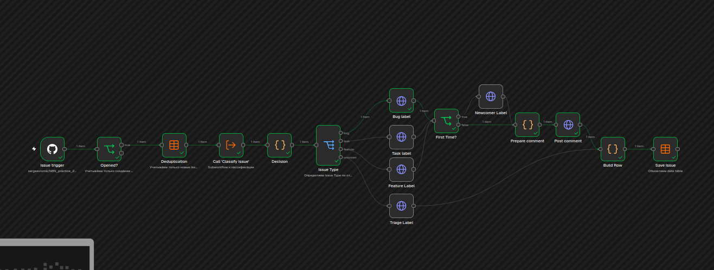
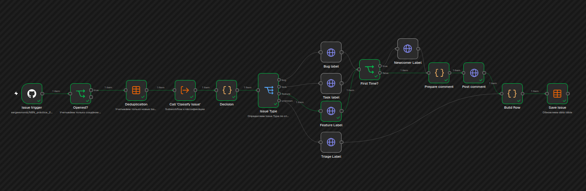
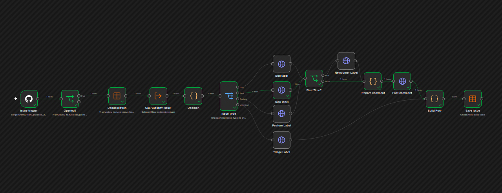
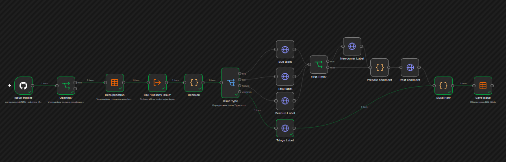

# Отчёт по практике 7.2: поддержка пользователя с помощью AI-инструментов

## Окружение

- Тестовый репозиторий: [sergeevroma/N8N_practice_2](https://github.com/sergeevroma/N8N_practice_2).
- Проект: Tiny Notes — консольный блокнот на Python с JSON-хранилищем,
  командами `add`, `list`, `search` и аргументом `--file`.
- Модель классификатора: `openai/gpt-5`, провайдер VseLLM.
- Основной сценарий: [01_issue_triage.json](workflows/01_issue_triage.json).
- Sub-workflow классификатора: [01_classify_issue.json](workflows/01_classify_issue.json).

## 1. Классификация Issues: bug / task / feature

**Статус:** выполнено. Проверены реальные запуски для трёх типов Issues.

**Workflow:** [01_issue_triage.json](workflows/01_issue_triage.json).

**Что настроено:** `Issue trigger` подписан на события `issues` репозитория
`sergeevroma/N8N_practice_2`. `Opened?` пропускает только `body.action = opened`.
До вызова модели выполняется проверка `issue_id` в Data Table. Основной сценарий
вызывает классификатор, `Decision` применяет порог уверенности, а `Issue Type`
выбирает ветку `bug`, `task`, `feature` или `unknown`.

В обычных ветках HTTP Request добавляет соответствующий лейбл. Затем проверяется
новый участник: при `author_association = NONE` добавляется `first-time-contributor`.
`Prepare comment` формирует один ответ, включающий приветствие со ссылкой на
CONTRIBUTING.md при необходимости. После успешной публикации выполняется сохранение.

| Проверка | Ожидаемый результат | Фактический результат | Доказательство |
|---|---|---|---|
| Баг: поиск `milk` не находит заметку `Buy Milk` | `type = bug`, confidence не ниже 0.8, лейбл `bug` | `bug`, confidence **0.97**; выполнена ветка `Bug label`, опубликован комментарий, выполнено сохранение | [Issue #5](https://github.com/sergeevroma/N8N_practice_2/issues/5), [Execution](screenshots/01_bug.png), [Data Table](screenshots/06_data_table_workflow_1.png) |
| Предложение экспорта в Markdown | `type = feature`, confidence не ниже 0.8, лейбл `feature` | `feature`, confidence **0.96**; выполнена ветка `Feature Label`, опубликован комментарий, выполнено сохранение | [Issue #6](https://github.com/sergeevroma/N8N_practice_2/issues/6), [Execution](screenshots/02_feature.png), [Data Table](screenshots/06_data_table_workflow_1.png) |
| Вопрос о выборе JSON-хранилища через `--file` | `type = task`, confidence не ниже 0.8, лейбл `task` | `task`, confidence **0.98**; выполнена ветка `Task label`, опубликован комментарий, выполнено сохранение | [Issue #8](https://github.com/sergeevroma/N8N_practice_2/issues/8), [Execution](screenshots/03_task.png), [Data Table](screenshots/06_data_table_workflow_1.png) |

На скриншотах показаны выполненные ветки основного workflow. Во всех трёх случаях
успешно завершились вызов классификатора, установка лейбла, публикация комментария
и `Save Issue`.

## 2. Эскалация при низкой уверенности

**Статус:** выполнено. Расплывчатый Issue с confidence **0.3** обработан через
`needs-triage` без автоматического комментария.

**Workflow:** [01_issue_triage.json](workflows/01_issue_triage.json).

**Как принимается решение:** `Decision` разрешает обычную обработку, если тип
входит в `bug/task/feature` и `confidence >= 0.8`. В остальных случаях итоговый
тип становится `unknown`, при этом фактический confidence сохраняется.
Выход `unknown` ведёт в `Triage Label`, затем напрямую в `Build Row` и `Save Issue`.
Ноды `First Time?`, `Prepare comment` и `Post comment` на этом пути не вызываются.

| Проверка | Ожидаемый результат | Фактический результат | Доказательство |
|---|---|---|---|
| Расплывчатый Issue | При confidence ниже 0.8 — метка `needs-triage`, автоматический комментарий отсутствует | `unknown`, confidence **0.3 < 0.8**; выполнена ветка `unknown → Triage Label → Build Row → Save Issue`; ноды приветствия и публикации комментария не выполнялись | [Issue #7](https://github.com/sergeevroma/N8N_practice_2/issues/7), [Execution](screenshots/04_needs_triage.png), [Data Table](screenshots/06_data_table_workflow_1.png) |

На скриншоте виден обход `First Time?`, `Prepare comment` и `Post comment`.
Приветствие здесь также не публикуется — это соответствует правилу эскалации.
В `processed_issues` для Issue #7 сохранены `type = unknown` и `confidence = 0.3`,
что подтверждает обработку при уверенности ниже порога 0.8.

## 3. Sub-workflow классификатора и сохранение обработанных Issues

**Статус:** выполнено. На скриншотах основного workflow видны успешные вызовы
классификатора и сохранение обработанных Issues.

**Workflow:** [основной сценарий](workflows/01_issue_triage.json) и
[классификатор](workflows/01_classify_issue.json).

**Что передаётся:** `Call 'Classify Issue'` передаёт `title = body.issue.title`
и `body = body.issue.body ?? ''` из данных триггера, запускается отдельно для каждого item и ждёт
завершения sub-workflow. Классификатор получает эти два поля через
`When Executed by Another Workflow`. `LLM with system prompt` использует
GPT-5 и Structured Output Parser. Последняя нода `Return Classification`
возвращает плоский объект с `type` и `confidence`.

| Проверка | Ожидаемый результат | Фактический результат | Доказательство |
|---|---|---|---|
| Основной workflow вызывает `Classify Issue` для нового Issue | В sub-workflow переданы title/body, возвращены type/confidence, основной сценарий продолжил нужную ветку | `Call 'Classify Issue'` успешно выполнена; после неё отработали `Decision`, соответствующая ветка и `Save Issue` | [bug](screenshots/01_bug.png), [feature](screenshots/02_feature.png), [task](screenshots/03_task.png), [needs-triage](screenshots/04_needs_triage.png) |

Все типы проверены с подключённым sub-workflow. Вызов подтверждается выполненной
нодой `Call 'Classify Issue'` на общих скриншотах, а состав передаваемых полей
и формат результата — приложенными JSON-экспортами.

**Таблица:** `processed_issues`. В схеме `Save Issue` полученного экспорта:

| Колонка | Тип | Назначение |
|---|---|---|
| `issue_id` | String | ID Issue, ключ дедупликации |
| `issue_number` | String | Номер Issue; `Build Row` преобразует его через `String(d.issue_number)` |
| `author` | String | Группировка недельной статистики по автору |
| `type` | String | Итоговый тип после применения порога уверенности |
| `confidence` | Number | Фактическое значение от классификатора |
| `processed_at` | Date | Время завершения обработки, фильтр недельной выборки |

`issue_url` берётся из API-адреса Issue и передаётся в JSON `Decision` для запросов
`/labels` и `/comments`; в таблицу он не записывается. `Save Issue` делает Upsert
по `issue_id` после успешного комментария или установки `needs-triage`.

**Результат сохранения:** после обработки Issues #5–9 в `processed_issues`
находятся пять записей. На снимке видны ID и номера Issues, авторы, итоговые типы,
confidence и время обработки.

| Issue | Автор | Тип | Confidence |
|---|---|---|---|
| #5 | `sergeevroma` | `bug` | 0.97 |
| #6 | `sergeevroma` | `feature` | 0.96 |
| #7 | `al3ksandraa` | `unknown` | 0.3 |
| #8 | `sergeevroma` | `task` | 0.98 |
| #9 | `WildBoar228` | `feature` | 0.95 |

**Проверка нового участника:** для [Issue #9](https://github.com/sergeevroma/N8N_practice_2/issues/9)
с предложением удаления заметки по ID выполнена ветка `feature`, затем
`First Time? → true → Newcomer Label → Prepare comment → Post comment`.
В комментарий добавляется приветствие автора и ссылка на `CONTRIBUTING.md`;
после публикации выполнены `Build Row` и `Save Issue`.

| Проверка | Ожидаемый результат | Фактический результат | Доказательство |
|---|---|---|---|
| Понятный Issue от внешнего автора с `author_association = NONE` | Лейблы `feature` и `first-time-contributor`, комментарий с приветствием и ссылкой на правила | Выполнены `Feature Label`, `Newcomer Label`, `Post comment` и `Save Issue` | [Issue #9](https://github.com/sergeevroma/N8N_practice_2/issues/9), [Execution](screenshots/05_newcomer.png) |

**Дедупликация:** перед вызовом модели `Deduplication` проверяет отсутствие
`issue_id` в `processed_issues`; `Always Output Data` выключен. Повторный `opened`
для сохранённого Issue должен завершиться на этой ноде. Отдельный тест повторной
доставки события в приложенных скриншотах не представлен.

## 4. Еженедельная статистика: Cron и группировка

**Статус:** сценарий статистики и подтверждения запусков ещё не предоставлены.

**Планируемая реализация:** Cron `0 9 * * MON`, timezone `Europe/Moscow`;
источник данных — обработанные Issues из `processed_issues` за прошлую неделю.
В тестовом наборе должно быть не меньше четырёх Issues, покрывающих bug, feature,
task и unknown. Code группирует выборку по типу и по автору.

| Проверка | Ожидаемый результат | Фактический результат | Доказательство |
|---|---|---|---|
| Cron и выборка за прошлую неделю | Расписание настроено; в Execution видны границы периода и выбранные Issues | Ожидается реализация | Экспорт и Execution ещё не предоставлены |
| Группировка Code node | Сформированы количества по типам и авторам | Ожидается реализация | Результат Code в Execution ещё не предоставлен |

Планируемый экспорт: `workflows/02_weekly_report.json`. Планируемый скриншот
Execution: `screenshots/06_weekly_stats.png`. Один реальный запуск
может подтверждать выборку и группировку. Настройка Cron проверяется по экспорту;
ждать понедельника для ручной проверки не требуется.

## 5. HTML-отчёт через Gmail

**Статус:** отправка и полученное письмо ещё не подтверждены.

**Планируемая реализация:** Gmail node отправляет HTML-письмо с таблицами
недельной статистики по типам и авторам.

| Проверка | Ожидаемый результат | Фактический результат | Доказательство |
|---|---|---|---|
| Отправка недельного отчёта | Gmail node успешно выполнена, HTML-письмо получено адресатом | Ожидается реализация | Execution отправки и скриншот письма ещё не предоставлены |

Планируемый файл полученного письма: `screenshots/weekly_report.png`.
Скриншот делается из Gmail с видимыми темой и содержимым таблиц. При выполнении
звёздочки тот же итоговый снимок должен показывать Δ и AI-комментарий недели.

## 6. Задание со звёздочкой: снимки недель, Δ и AI-комментарий

**Статус:** аналитический сценарий, две недели в Data Table и итоговое письмо
ещё не предоставлены.

**Планируемая реализация:** недельные агрегаты сохраняются в `weekly_stats`.
Отдельный workflow аналитики читает текущую и предыдущую календарную неделю,
вычисляет Δ и передаёт агрегаты вместе с изменениями в Basic LLM Chain.
Результат возвращается в сценарий рассылки и попадает в блок
«AI-комментарий недели» того же письма.

| Проверка | Ожидаемый результат | Фактический результат | Доказательство |
|---|---|---|---|
| Сохранение статистики | В Data Table есть недельные снимки минимум за два периода | Ожидается реализация | Содержимое weekly_stats ещё не предоставлено |
| Расчёт Δ | Изменения рассчитаны по сохранённой предыдущей неделе и показаны в письме | Ожидается реализация | Execution расчёта и письмо ещё не предоставлены |
| AI-аннотация | Basic LLM Chain получает статистику и Δ; текст выведен в письме | Ожидается реализация | Execution LLM и письмо ещё не предоставлены |

Планируемый экспорт: `workflows/03_weekly_analysis.json`. Планируемые снимки:
`screenshots/07_weekly_analysis.png` и
`screenshots/weekly_stats.png`. Предыдущую неделю разрешено сымитировать
тестовой записью согласно README; при таком тесте искусственное происхождение
записи будет явно указано в отчёте.

## Артефакты для сдачи

В отчёт включаются только виды артефактов, перечисленные в README практики 7.2:

| Артефакт | Что уже предоставлено | Что ещё нужно |
|---|---|---|
| Экспорты всех использованных сценариев в JSON | [Workflow 1](workflows/01_issue_triage.json) после исправлений и [классификатор](workflows/01_classify_issue.json) | Добавить статистику и отдельную аналитику |
| Репозиторий с Issues всех типов, включая needs-triage | [bug #5](https://github.com/sergeevroma/N8N_practice_2/issues/5), [feature #6](https://github.com/sergeevroma/N8N_practice_2/issues/6), [needs-triage #7](https://github.com/sergeevroma/N8N_practice_2/issues/7), [task #8](https://github.com/sergeevroma/N8N_practice_2/issues/8), [новичок #9](https://github.com/sergeevroma/N8N_practice_2/issues/9) | — |
| Скриншоты выполненных шагов | Пять скриншотов Workflow 1 в [screenshots](screenshots) и [Data Table после пяти Issues](screenshots/06_data_table_workflow_1.png), включая типы и confidence | Статистика, Gmail и аналитика |
| Скриншот полученного письма | Пока не предоставлен | Итоговое HTML-письмо в Gmail |
| Содержимое Data Table минимум за две недели для звёздочки | Пока не предоставлено | weekly_stats с двумя недельными снимками |

Для Workflow 1 приложены общие скриншоты пяти выполненных сценариев с видимыми
ветками обработки и скриншот `processed_issues` с результатами всех пяти запусков.
Вызов sub-workflow показан на общих снимках. Результаты
в GitHub доступны по ссылкам на Issues. Подтверждения следующих workflow будут
добавлены после их выполнения.

## Итог сдачи

- [x] Исправлен и переэкспортирован Workflow 1.
- [x] Подтверждены три типа Issues и эскалация при confidence 0.3 < 0.8 без комментария.
- [x] Подтверждён реальный вызов sub-workflow.
- [x] Подтверждены ветка нового участника, публикация комментария и сохранение.
- [ ] Подтверждены Cron, недельная выборка и группировка по типу и автору.
- [ ] Получено HTML-письмо через Gmail node.
- [ ] Для звёздочки показаны два недельных снимка, Δ и AI-комментарий.
- [x] Вставлены реальные ссылки на пять Issues и скриншоты Workflow 1.
- [ ] Добавлены подтверждения статистики, Gmail и аналитики.

Задача на сверхрезультат с автоматическим исправлением и merge в объём работы
не входит.
