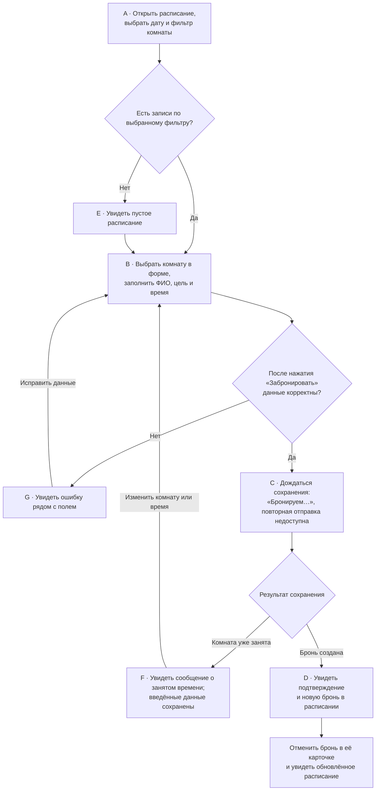
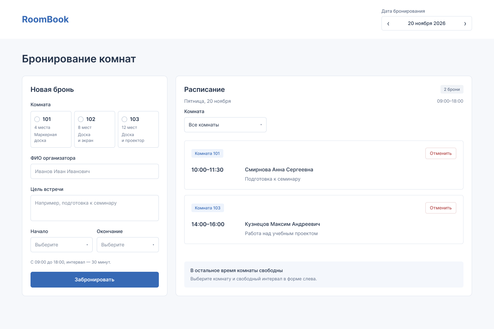
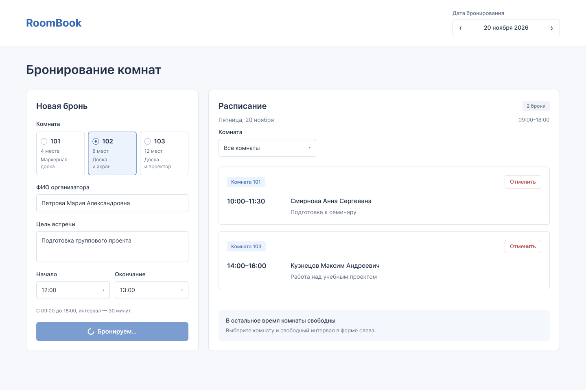
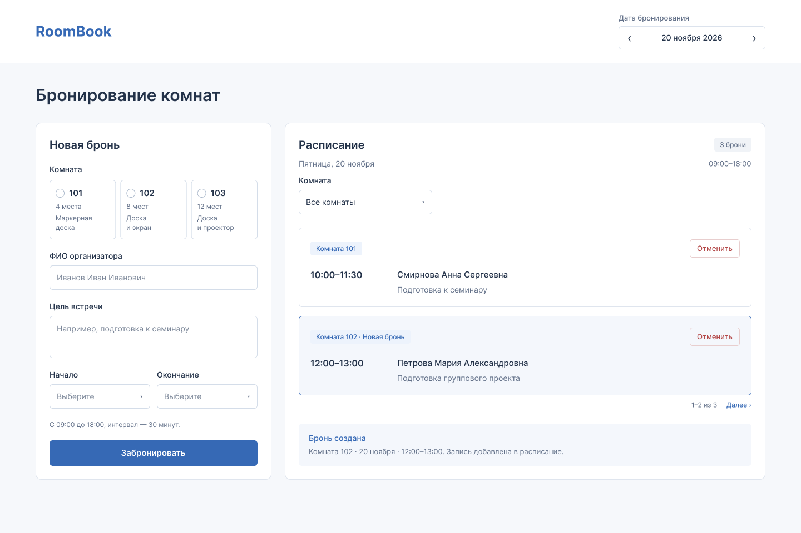
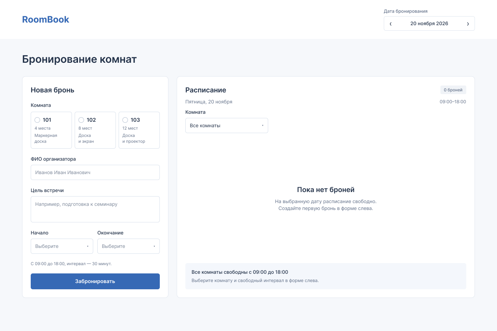
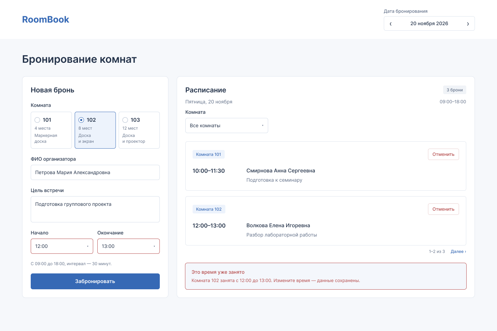
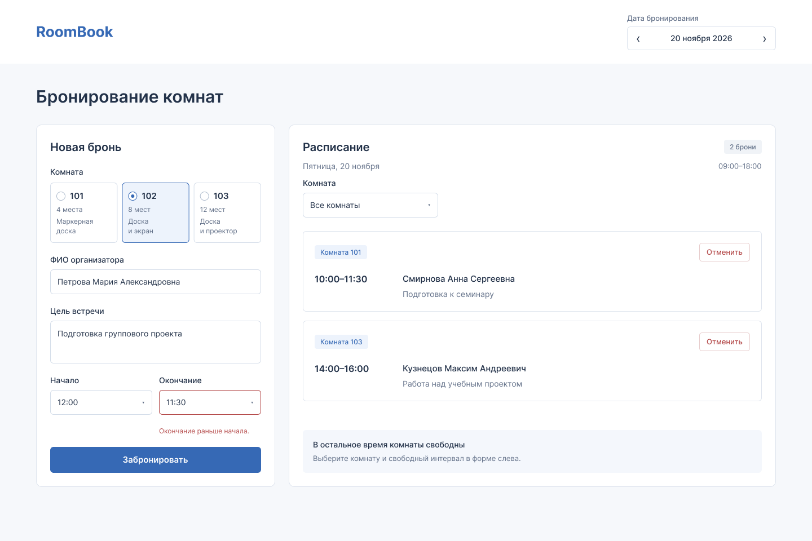

# RoomBook

RoomBook ведёт общее расписание учебных комнат небольшого учебного центра.
Студенты и преподаватели бронируют их для командной работы, консультаций
и подготовки к занятиям. За встречу отвечает указанный в бронировании организатор.

## Комнаты

| Комната | Мест | Оборудование |
|---|---:|---|
| 101 | 4 | Маркерная доска |
| 102 | 8 | Маркерная доска, экран |
| 103 | 12 | Маркерная доска, проектор |

## Правила бронирования

- Организатор выбирает:
    1. номер комнаты,
    2. дату бронирования
    3. указывает своё ФИО и цель брони,
    4. выставляет желаемое время начала и окончания
- Бронь сразу занимает выбранный интервал,дополнительное согласование не требуется.

- Комнаты доступны ежедневно с 09:00 до 18:00 по московскому времени.
- Встреча проходит в пределах одного дня, время задаётся с шагом 30 минут.
- Окончание должно быть позже начала. Две встречи в одной комнате не могут
пересекаться, но могут идти подряд: например, 10:00–11:00 и 11:00–12:00.
- В разных комнатах встречи могут проходить одновременно.
- По дате и длительности встречи можно подобрать свободные интервалы.
- Бронирование можно отменить — время снова станет доступно. Изменение встречи
выполняется отменой старой брони и созданием новой.

Это общее расписание доверенной учебной группы: аккаунтов и разграничения
прав нет, имя организатора указывается вручную. Участники видят все брони
и могут отменять их. Данные сохраняются между запусками приложения.

## Фронтенд

- Интерфейс адаптируется к ширине окна: на широких экранах форма и расписание располагаются рядом, на узких — друг под другом. Горизонтальная прокрутка страницы не требуется.
- Слева расположена форма новой брони, справа — расписание.
- Дата бронирования в шапке является общей для формы и расписания.
- Отдельный селектор комнаты в блоке расписания фильтрует список и не меняет выбор комнаты в форме.
- Макеты созданы с помощью AI. После проверки удалены надписи, дублирующие логику элементов, а дополнительным запросом добавлен явный селектор комнаты в расписании.

### Начальный экран

Начальная страница доступна с `/` после запуска FastAPI.
Её разметка находится в `src/front/index.html`, общие цвета, типографика,
отступы и адаптивная раскладка — в `src/front/styles.css`.
Bootstrap 5.3.9 хранится локально в `src/front/vendor/`.
`src/front/app.js` получает комнаты, правила времени и расписание из API.
Дата по умолчанию — сегодняшний день по московскому времени. Смена даты и фильтра
обновляет карточки и счётчик; при загрузке показан индикатор, при ошибке доступен повтор.
Примерные записи из HTML удалены: пустая база отображается как пустое расписание.
Форма создаёт бронь через API: проверяет поля, блокирует повторную отправку,
показывает результат и обновляет расписание. При ошибке заполненные поля сохраняются.
После успеха форма очищается, фильтр переключается на «Все комнаты», новая запись выделяется.
Любую бронь можно отменить кнопкой в её карточке.

### Запуск и проверка

Из корня RoomBook, Python 3.11+:

```sh
python3 -m venv .venv
.venv/bin/python -m pip install -r requirements.lock
.venv/bin/python -m uvicorn roombook.main:create_app --factory --reload
```

Страница: `http://127.0.0.1:8000/`. Дополнительные настройки не обязательны;
`ROOMBOOK_DB` позволяет изменить путь к SQLite-файлу.
Для тестов один раз установите Chromium, затем запустите проверку:

```sh
PLAYWRIGHT_BROWSERS_PATH="$PWD/.venv/playwright-browsers" .venv/bin/python -m playwright install chromium --only-shell
sh scripts/check.sh
```

[Скриншоты, результаты проверок и использование AI](evidence/README.md).

### Главный User Flow

Как студент или преподаватель, я хочу выбрать комнату и время для учебной
встречи, указать организатора и цель, создать бронь и увидеть её в расписании,
чтобы выбранное время было закреплено за встречей.



### Макеты по узлам сценария

Буквы A–G соответствуют узлам диаграммы. В карточке каждой брони доступна
кнопка «Отменить» в соответствии с правилами общего расписания.

<details>
<summary>A — исходный экран и просмотр расписания</summary>

Пустая форма, существующие бронирования, выбор даты и отдельный фильтр комнаты.



</details>

<details>
<summary>B — заполненная форма</summary>

Выбрана комната 102, указаны ФИО, цель встречи и интервал 12:00–13:00.


</details>

<details>
<summary>C — ожидание сохранения</summary>

Кнопка показывает индикатор и текст «Бронируем…». Во время ожидания
повторный клик или Enter не должны создавать ещё один запрос.



</details>

<details>
<summary>D — успешное бронирование</summary>

Новая запись выделена в расписании, показано подтверждение с комнатой и временем,
форма очищена для следующего бронирования.



</details>

<details>
<summary>E — пустое расписание</summary>

Для выбранной даты и фильтра записей нет; пользователь может создать первую бронь.



</details>

<details>
<summary>F — выбранное время уже занято</summary>

Сохранение отклонено из-за пересечения с другой бронью. Введённые данные остаются
в форме, пользователь может изменить комнату или время и отправить её снова.



</details>

<details>
<summary>G — ошибка ввода времени</summary>

Окончание 11:30 задано раньше начала 12:00. Поле выделено, рядом показано
объяснение; пользователь исправляет время до отправки запроса.



</details>

## Стек и библиотека компонентов

Для реализации интерфейса выбран следующий стек:

| Часть | Технологии |
|---|---|
| Фронтенд | HTML5, CSS3, JavaScript; запросы к API через `fetch` |
| Библиотека компонентов | Bootstrap 5.3 |
| Бэкенд | Python, FastAPI, Pydantic |
| Хранение данных | SQLite |
| Клиентские тесты | pytest + Playwright: действия в браузере и подмена ответов API |
| Тесты бэкенда | pytest + FastAPI TestClient |

В интерфейсе переиспользуются готовые компоненты Bootstrap: карточки,
поля форм, переключатели комнат, выпадающие списки, кнопки, уведомления,
счётчик бронирований и индикаторы загрузки.
Цвета, шрифт, отступы и видимый фокус
задаются единообразно в общих CSS-стилях.

Команды установки, запуска и проверки приведены в [инструкции разработчика](docs/development.md).
Поведение интерфейса и план реализации описаны в [спецификации](docs/frontend-spec.md).
